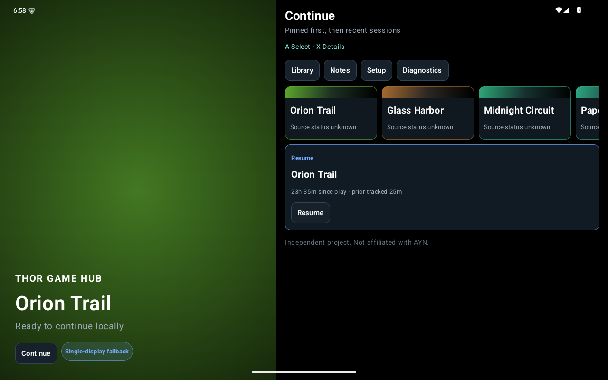
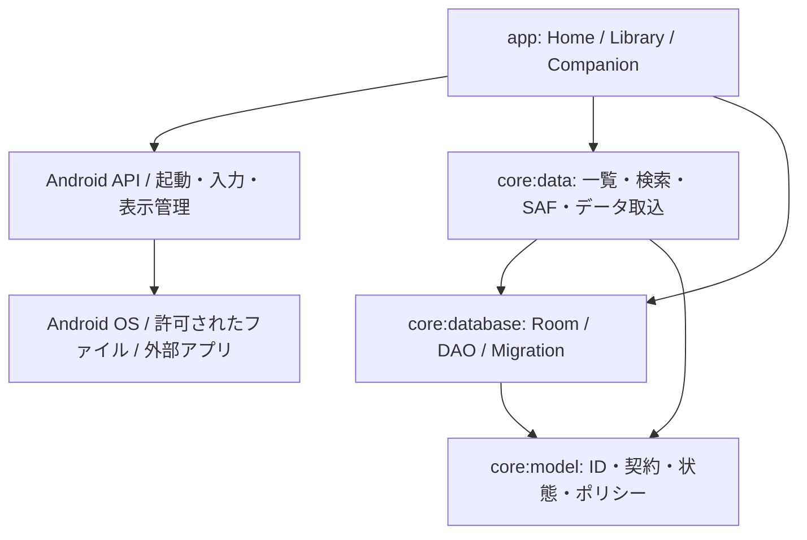

# Thor Game Hub

**AYN Thor向けに開発した、ゲームライブラリ管理と2画面の操作支援を行うAndroidランチャーです。** Kotlin / Jetpack Compose / Roomを使用しています。

> 個人開発のポートフォリオ用スナップショットです。開発には **OpenAI Codex** を活用し、実装・修正・テストに生成AIの支援を取り入れています。
>
> AYNとは関係のない独立したプロジェクトです。現在は **debug版の開発候補** です。ホストでのビルド・テスト、エミュレータでの表示と、実機の2画面・操作・ゲーム起動の検証範囲を区別しています。

## 開発の背景と解決したかった課題

複数のゲームや起動先をまとめて探し、プレイの再開やメモを管理しやすくすることを目的に開発しました。AYN Thorの2画面を想定し、メインのライブラリ画面と補助画面を分けています。Androidの画面IDを固定することや、外部アプリへの起動要求だけで成功と判断することを避け、端末ごとの状況を確認できる仕組みを重視しました。

## 主要機能

| 機能 | 実装内容 |
| --- | --- |
| ゲームライブラリ | 検索・プラットフォーム等の絞り込み、詳細、メモ、コレクション |
| 2画面の構成 | DisplayManagerによる動的検出、Home / Companion、単画面へのフォールバック |
| ローカルデータ | Roomによるゲーム・起動方法・プレイ履歴等の保存、明示的なスキーマ移行 |
| ファイル参照 | SAFでユーザーが許可したフォルダを参照。アクセス不可でも履歴は保持 |
| 外部アプリ起動 | Android / RetroArch / GameNative等の起動要求を扱うアダプタ |
| セッション | プレイ時間、終了メモ、再起動・プロセス中断からの回復処理 |
| 保存データ | 許可された保存先のスナップショットと明示的な復元経路 |
| 操作・診断 | コントローラ入力、フォーカス、タッチ、大きな文字、診断出力 |

詳細は [実装と未検証範囲](docs/STATUS.md) を参照してください。ROM・BIOS・エミュレータ・ゲーム画像・個人のセーブデータは同梱していません。

## 画面例



公開用コピーを新規のAPI 35エミュレータで起動し、内蔵の架空ライブラリを表示した画面です。個人端末や実際のゲームデータは使用していません。単画面での表示例であり、Thor実機の2画面動作を証明するものではありません。

## 使用技術

| 役割 | 技術 |
| --- | --- |
| 言語 | Kotlin |
| UI | Jetpack Compose、Material 3、Navigation、Lifecycle |
| 永続化 | Room、DataStore |
| 一覧・バックグラウンド | Paging、WorkManager |
| 非同期・DI | Coroutines / Flow、Hilt |
| Android API | DisplayManager、ActivityOptions、HOME role、SAF |
| テスト・静的解析 | JUnit、Truth、Turbine、AndroidX Test、Lint |
| ビルド | JDK 17、Gradle 9.5.0、AGP 9.3.0 |

依存バージョンは `gradle/libs.versions.toml` に記載しています。

## システム構成



Android依存のないモデル、Roomによる保存、ファイル取込、画面・OS連携を4モジュールへ分けています。詳細は [アーキテクチャ](docs/ARCHITECTURE.md) を参照してください。

## 開発環境・セットアップ

- JDK 17
- Android SDK Platform **37.0**
- Android SDK Build Tools **36.0.0**
- 実行先はAndroid 13 / API 33以上

```bash
git clone https://github.com/yuzu-rhythm/ThorGameHub.git
cd ThorGameHub
# JAVA_HOMEにJDK 17、ANDROID_HOMEに自分のAndroid SDKを設定
export JAVA_HOME="/absolute/path/to/jdk-17"
export ANDROID_HOME="/absolute/path/to/android-sdk"
./gradlew :app:assembleStandardDebug --no-daemon
```

SDKとJDKは各自で用意してください。ローカルSDKパスを記した `local.properties` や署名鍵は公開しません。このアプリは外部APIキーや `.env` を必要としないため、ダミーの認証設定ファイルは追加していません。

## 実行方法

最初は、自分で用意した**使い捨てエミュレータ**での確認を推奨します。

```bash
# <EMULATOR_SERIAL> は自分の検証用エミュレータのIDに置き換える
adb -s <EMULATOR_SERIAL> install -r app/build/outputs/apk/standard/debug/app-standard-debug.apk
adb -s <EMULATOR_SERIAL> shell am start -W -n dev.thorhub.app.debug/dev.thorhub.app.HomeActivity
```

初回起動では、コード内の架空のゲーム情報を使用して画面を確認できます。実際のROMファイルや認証情報は不要です。架空の項目は実ゲームを起動できるデータではありません。

2画面の割当てやHOMEアプリへの設定は、Androidの確認画面を通じて利用者が判断します。補助画面の起動要求・アプリ自身が観測した表示先・人が確認した実パネルをそれぞれ分けて記録します。

## テスト・動作確認の実績

公開用コピーで実施した結果と環境は [検証記録](docs/VALIDATION.md) に記載します。過去の実機記録を、今回の公開用APKの実績として転記していません。

```bash
THOR_RUN_CONNECTED_TESTS=0 ./scripts/verify.sh
```

このコマンドはホストでのテスト、Androidテストコードのコンパイル、Lint、debug APKのビルドを行います。実機へのインストールやHOME変更は行いません。公開用スクリプトはホスト検証専用で、Connectedテスト指定がある場合は処理を停止します。

## 開発で工夫した点

- **端末固有の条件への対応**：下画面のIDを決め打ちせず、その時点の画面構成を検出します。
- **成功の判定を分ける**：Androidが起動要求を受け付けたことと、ゲームが意図した画面で動いたことを別に扱います。
- **データを失いにくい管理**：ゲームのファイルやアプリが見つからなくなっても、管理情報・メモ・履歴を残します。
- **復元時の保全**：手動復元の前にスナップショットを要求し、プレイ中の復元をブロックします。
- **表示と操作の配慮**：最低文字倍率1.28倍、スクロール、フォーカス、タッチとコントローラの両方に対応する実装です。
- **検証しやすい構造**：Androidから独立したモデルのテストと、Android上のテストを分離しています。

## 今後の改善予定

- Thor実機で上下パネル、タッチ、コントローラ、蓋、音声等を確認
- 外部ゲームの個別起動と、画面配置をアダプタごとに検証
- 使い捨ての保存データでバックアップ・復元・中断回復を確認
- 長時間運用、アクセス権変更、大量ライブラリの条件を拡充
- リリース署名・配布条件・CIを整備

クラウド同期、特権操作、スクリーンショット取得は現在の有効な機能として実装していません。

## 公開・ライセンス

[公開前の点検](docs/SECURITY_REVIEW.md)、[第三者ライブラリ・素材](THIRD_PARTY_NOTICES.md) を記載しています。Gradle Wrapperのライセンス文・通知は `docs/licenses/` に同梱しています。

本スナップショットでは、オリジナルコード全体へ新たなOSSライセンスを付与していません。再利用・再配布を許可する範囲は作者が別途選択します。
